<div align="center">


</div>

<br>

## `~/stack`

```text
lenguajes     python · c · c++
sistema       kali linux · linux
herramientas  hashcat · metasploit · wireshark
metodología   owasp
datos         probabilidad · estadística descriptiva
entorno       git · vs code
```

<br>

## `~/estadistica-x-seguridad`

Estudio estadística y ciberseguridad al mismo tiempo, y me interesa lo que pasa cuando se cruzan: la estadística sirve para encontrar lo que no encaja. El gráfico se genera con [`codigo/anomalias.py`](codigo/anomalias.py): tráfico **simulado**, una línea base con mediana móvil y un z-score modificado (MAD) que no se deja engañar por los propios picos.

<div align="center">



</div>

```text
estadística                          seguridad
─────────────────────────────────    ──────────────────────────────────────────────
probabilidad                      →  fuerza bruta y entropía de contraseñas
estadística descriptiva           →  línea base del tráfico, detección de anomalías
series de tiempo         (próximo) →  monitoreo y análisis de logs
criptografía             (próximo) →  matemática discreta y probabilidad detrás del cifrado
```

Un ejemplo pequeño de ese cruce, cuántos bits de entropía tiene una contraseña al azar:

```python
import math

def entropia_bits(longitud, tamano_alfabeto):
    return longitud * math.log2(tamano_alfabeto)

entropia_bits(8, 94)    # ≈ 52.4 bits  →  94^8  ≈ 6.1 × 10^15 combinaciones
entropia_bits(16, 94)   # ≈ 104.9 bits →  cada bit extra duplica el trabajo del atacante
```

<br>

## `~/ruta.log`

```text
[x] hecho    [~] en curso    [ ] por venir

# academia
[x] sistemas operativos        gestión de SO I y II · windows · linux · shell scripting
[x] probabilidad               + estadística descriptiva
[~] redes                      modelo OSI y TCP/IP · direccionamiento IP · LAN
[~] programación               algoritmos · estructuras de datos
[ ] criptografía
[ ] pruebas de penetración · análisis forense · gestión de riesgo
[ ] inferencia · series de tiempo · modelos lineales · análisis multivariado

# laboratorio
[~] auditorías sobre mis propias redes
[~] herramientas propias en python y c/c++
[ ] entorno virtual aislado para practicar (kali + máquinas vulnerables)
[ ] write-ups: documentar lo que voy aprendiendo
```

<br>

<div align="center">

`// todo el trabajo se realiza sobre redes y sistemas propios o con autorización expresa`

<sub><i>"Who looks outside, dreams; who looks inside, awakes."</i></sub>

</div>
